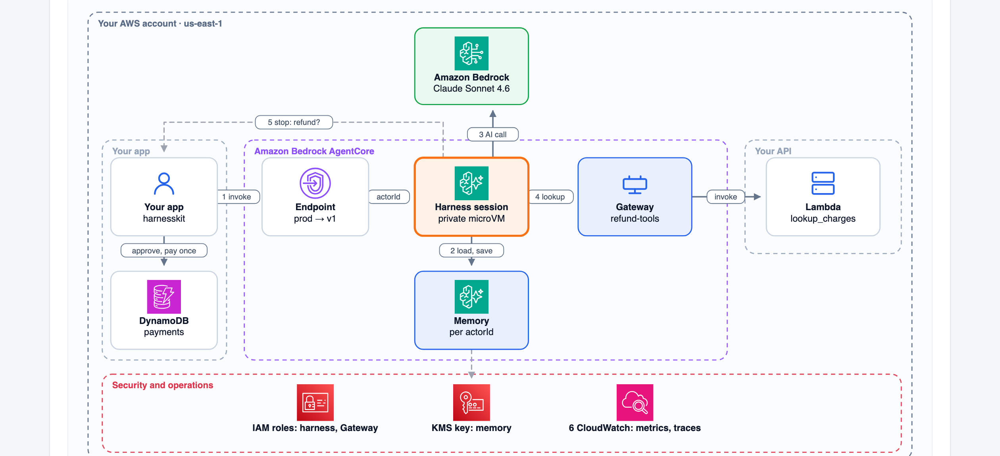

# Project 6: A Refund Agent on the AgentCore Harness

A working kit you deploy to your own AWS account. It pairs with the walkthrough
[How Does the AgentCore Harness Work?](https://nmadiraju.com/posts/genai-how-agentcore-harness-works/): the
walkthrough explains each decision; this kit is the tested code and templates behind it. Every make target is
one step of the walkthrough.

Tested end to end in us-east-1 on Nov 9, 2026. **It costs money while deployed. Run `make teardown` when
you're done.**



## What you deploy

| Box in the diagram | What it is | Created by | How it's reached |
|---|---|---|---|
| Your app (harnesskit) | The Python client in `harnesskit/`. In production this is your backend | You run it | It calls AgentCore over HTTPS, signed with your AWS credentials |
| Endpoint `prod` | A named pointer on the harness that pins one version | `ProdEndpoint` in `infra/harness.yaml` | `qualifier=prod` on the request |
| Harness session | The agent loop in a private microVM, one per session ID | `Harness` in `infra/harness.yaml` | The session ID header on the request |
| Memory | Managed AgentCore Memory, separated by `actorId` | Created with the harness | The harness loads and saves it on every request |
| Gateway `refund-tools` | Presents your Lambda to the AI as an MCP tool | `Gateway`, `ChargesTarget` | The harness, with its execution role (`InvokeGateway`) |
| Lambda `lookup_charges` | Read-only charge lookup with fake data | `ChargesFunction` | Gateway, with the Gateway role |
| Bedrock model | `us.anthropic.claude-sonnet-4-6` | Already in Bedrock | The harness, with its execution role |
| DynamoDB `payments` | Stands in for the payment system. No real money moves | `PaymentsTable` | Your app, after a person approves |
| KMS key | Encrypts memory; can't be changed after creation | `MemoryKey` | AgentCore, on your behalf |
| IAM roles | The harness execution role (narrow), the Gateway role and the Lambda's own role | `HarnessRole`, `GatewayRole`, `ChargesFunctionRole` | Assumed by AgentCore and Lambda |
| CloudWatch | Metrics, alarms, and traces | Automatic; alarms in `ops/alarms.yaml` | |

## One request, on the wire

harnesskit sends one HTTPS request to the AgentCore service address. The harness and the endpoint are named in
the query string:

```
POST https://bedrock-agentcore.us-east-1.amazonaws.com/harnesses/invoke
       ?harnessArn=arn:aws:bedrock-agentcore:us-east-1:<account>:harness/refund_agent-<id>
       &qualifier=prod                                   <- the harness endpoint, so the version
X-Amzn-Bedrock-AgentCore-Runtime-Session-Id: refund-customer-1042-A-1042-<uuid>   <- which session
Authorization: AWS4-HMAC-SHA256 ...                                              <- SigV4

{"actorId": "customer-1042", "messages": [{"role": "user", "content": [{"text": "I was charged twice..."}]}]}
```

Leave out `qualifier` and the request goes to `DEFAULT`, which always follows the newest version. A caller of a
named endpoint needs IAM permission on both the harness ARN and the endpoint ARN.

## Before you start

- An AWS account and credentials that can create IAM roles, KMS keys, Lambda, DynamoDB and AgentCore resources.
- Bedrock model access to Claude Sonnet 4.6 in us-east-1 (the `us.` inference profile).
- Python 3.12. **boto3 1.43.32 or later**: 1.43.31 and earlier have no harness endpoints and no `qualifier`. The kit pins 1.43.126, the version it was tested with.

## Quick start

```sh
cd 06-agentcore-harness
python3 -m venv .venv && . .venv/bin/activate
make setup
make test        # 29 unit tests, offline
make deploy      # about 10 minutes the first time
make A1          # one refund, end to end
```

## The steps

| Step | What you see | Command |
|---|---|---|
| A1 | One refund: the harness looks up the charges through Gateway, stops at the refund, your app pays once | `make A1` |
| B1 | New instructions create version 2. `DEFAULT` moves at once; `prod` stays on version 1 | `make B1` |
| B1 | Promote `prod` after testing, or roll it back. In code: the `ProdVersion` parameter | `make B1-promote`, `make B1-rollback` |
| B2 | The refund stops and asks you to approve it | `make B2` |
| B4 | Two customers, two `actorId`s: memory stays apart | `make B4` |
| C2 | The execution role the stack created | `make C2` |
| D1 | The app crashes after paying, before answering the harness | `make D1` |
| D2 | The restarted app answers the saved call; the payment system returns the first refund | `make D2 SESSION=<id from D1>` |
| D3 | Alarms and a CloudTrail trail for harness invokes; the metrics the harness emits | `make ops`, `make D3` |

## What the live test found

These differ from, or aren't in, the AWS documentation as of Nov 9, 2026:

1. **Memory permission.** The managed memory is named `memory/refund_agent-<id>`, after the harness. AWS's
   sample execution role uses `memory/harness_*`, which was denied. `infra/harness.yaml` scopes it to the real
   name.
2. **Tool results must be text.** A `toolResult` with a `json` content block fails with "unsupported type".
3. **Errors arrive while you read the stream.** boto3 raises `EventStreamError` mid-iteration rather than
   yielding an error event. `harnesskit/stream.py` handles both.
4. **After a crash, the session waits for the pending call.** The harness rejects any new message on that
   session until it gets the `toolResult` for the exact pending `toolUseId`. So harnesskit saves the call
   before paying (`harnesskit/pending.py`), and the idempotency key makes the repeated payment harmless.
5. **Memory isn't a safety net.** In one run, long-term memory remembered an earlier refund and the agent
   declined to refund again. Useful, but the idempotency key is what guarantees one payment.
6. **Metrics use the Runtime's name.** Request metrics are under namespace `AWS/Bedrock-AgentCore`,
   `Name = harness_refund_agent::prod`, `Operation = InvokeAgentRuntime`, plus the Runtime ARN. A wrongly
   scoped role shows up as `UserErrors` on `ListEvents`.
7. **Timing.** Creating the harness took about 8 minutes; moving the `prod` endpoint took about 5.

## Tracing (not tested here)

Harness traces need CloudWatch Transaction Search, a one-time setting for the whole account. It wasn't
turned on for this test, because it changes where every X-Ray trace in the account goes. To turn it on, follow
[AgentCore observability, getting started](https://docs.aws.amazon.com/bedrock-agentcore/latest/devguide/observability-get-started.html):
add the CloudWatch Logs resource policy for X-Ray, then
`aws xray update-trace-segment-destination --destination CloudWatchLogs`. `agentcore deploy` does this for you
if you use the AgentCore CLI.

## Not covered

- **VPC mode.** It needs private subnets, a NAT gateway and VPC endpoints, which this kit doesn't create.
- **Sign-in tokens** (a JWT authorizer) for per-user keys.

## Cost and teardown

A test run (a few dozen requests) costs a few dollars: model tokens, AgentCore Runtime and Memory, and small
Lambda, DynamoDB and CloudTrail charges. The KMS key costs about $1 a month until deleted.

```sh
make teardown    # deletes both stacks; the KMS key is scheduled for deletion after 7 days
```

## Files

```
infra/harness.yaml     the harness, prod endpoint, roles, memory key, Gateway, Lambda, payments table
ops/alarms.yaml        alarms on the prod endpoint, and a CloudTrail trail for harness invokes
harnesskit/            the client: stream reading, approval, payments, crash recovery, CLI, release report
tests/                 29 offline unit tests
docs/architecture.png  the diagram above
```
